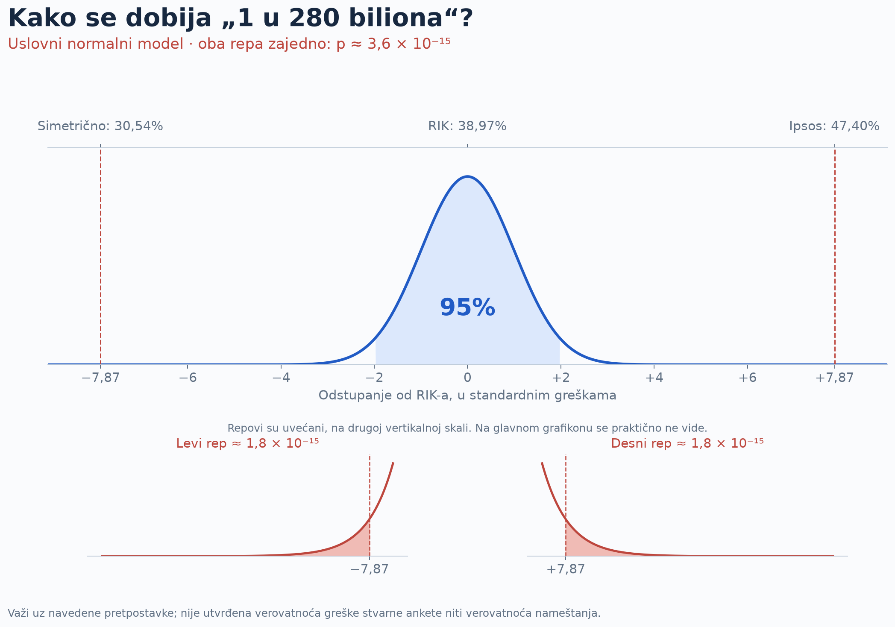
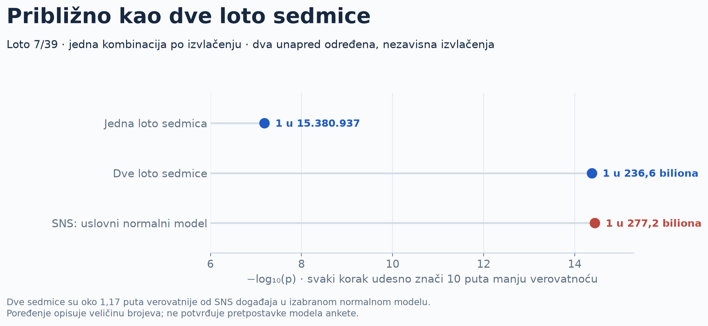

# Ipsos, verovatnoća i Loto

**Uslovna normalna analiza objavljenih izbornih procena 2026.**  
Autor: **Mihajlo Popesku** · verzija **1.0.0** · **01.11.2026.**

## Čitajte onlajn

| Dokument | Sadržaj |
| --- | --- |
| [Sažetak za javnost](https://mikelatenta.github.io/ipsos-verovatnoca-loto-2026/) | Glavni nalazi, grafikoni i poređenje sa Lotom, na srpskom. |
| [Statistika 101](https://mikelatenta.github.io/ipsos-verovatnoca-loto-2026/statistika-101.html) | Uzorkovanje, standardna greška, dve ose, repovi i račun korak po korak. |
| [Tehnički Python izveštaj](https://mikelatenta.github.io/ipsos-verovatnoca-loto-2026/tehnicki.html) | Izvršeni kod, pretpostavke, podaci, osetljivost, geografska provera i istorijski dodatak. |
| [Provera u R-u](https://mikelatenta.github.io/ipsos-verovatnoca-loto-2026/provera-r.html) | Nezavisna numerička provera istih ulaza. |

## Glavni rezultat i njegovo značenje

Za SNS, Ipsosovih **47,40%** naspram RIK-ovih **38,97%** daje razliku od **8,43 pp**. Iz objavljene margine **±2,10 pp na 95%** izvodimo `SE = 2.10 / 1.9599639845 = 1.071448... pp`, pa `z = 8.43 / SE = 7.867855...`.

U **normalnom modelu**, verovatnoća jednako velikog ili većeg odstupanja u bilo kom smeru iznosi **p ≈ 3,6077 × 10⁻¹⁵**, odnosno oko **1 u 277,2 biliona**, zaokruženo **1 u 280 biliona**. Bilion ovde znači 10¹².

> Ovo je uslovna dijagnostika modela izvedenog iz objavljene margine. Nije utvrđena verovatnoća greške stvarne ankete, verovatnoća hipoteze ili verovatnoća nameštanja. Sam 95% interval ne identifikuje ekstremne repove raspodele.

| Lista | Ipsos | RIK* | Razlika (pp) | &#124;z&#124; | Dvostrano p, normalni model |
| --- | --- | --- | --- | --- | --- |
| SNS / Ujedinjena Srbija | 47,40% | 38,97% | 8,43 | 7,868 | 3,608 × 10<sup>−15</sup> |
| Studentska lista | 40,00% | 53,03% | -13,03 | 12,161 | 5,007 × 10<sup>−34</sup> |


*RIK: **privremeni presek 30.10.2026. u 09:10**, 8.339/8.392 biračka mesta. Ne konačni rezultati. Dve marginalne verovatnoće se **ne množe**.



## Poređenje sa Lotom 7/39

`C(39,7) = 15380937`. Za jednu kombinaciju u jednom izvlačenju, sedmica ima verovatnoću `1 / 15380937`. Za po jednu kombinaciju u **dva unapred određena nezavisna izvlačenja**, dve sedmice imaju verovatnoću `1 / 15380937² = 4.22702107757e-15`, tj. **1 u 236,6 biliona**.

To je približno isti red veličine kao naš SNS normalni rep; dve sedmice su oko **1,17 puta verovatnije**. Jedna sedmica je oko **18,0 miliona puta verovatnija**. Poređenje ne odnosi se na mnogo kombinacija ili dve pobede bilo kada i ne potvrđuje model ankete.



## Provere i ograničenja

- Standardna greška proizlazi iz objavljene margine, ne iz pretpostavke da svih 3.624 ispitanika ulazi u stranačke udele. Relevantna neponderisana baza nije objavljena.
- Model pretpostavlja istu ciljnu populaciju i podršku, odsustvo pristrasnosti, ispravnu objavljenu preciznost i normalne repove. Neodaziv, ponderisanje, izlaznost i kasne promene nisu obuhvaćeni prostim normalnim repom.
- Pokazujemo scenarije sa većom standardnom greškom, zaokruživanjem margine i drugačijim oblikom raspodele sa istim centralnim 95% intervalom.
- Posebno prikazujemo udele među važećim glasovima bez rezultata KiM i inostranstva. To približava obuhvat; ne rekonstruiše ceo dizajn ankete.
- Dodatak za 2012. je jasno označen kao ilustrativan binomni scenario sa nepoznatom relevantnom bazom i desetodnevnim razmakom. Ne spajamo ga u „zajedničku verovatnoću“ sa 2026.
- Račun ne utvrđuje uzrok odstupanja ili nameru. Za potpunu reviziju potrebna je metodologija i odgovarajuće anonimizovani podaci.

## Ponovite račun

Osnovni račun, **bez instaliranja biblioteka**, Python ≥3.11:

```bash
python analysis/core.py
```

Za sve grafikone, izvršeni notebook, izveštaje i nezavisnu R proveru:

```bash
python -m venv .venv
source .venv/bin/activate
python -m pip install -r requirements.txt
python analysis/core.py
Rscript analysis/verify.R
python build.py
python -m unittest discover -s tests -v
```

R ≥4.2; dodatni R paketi nisu potrebni. Za punu izradu preporučen je Python 3.12. Ne pokreću se masovne simulacije: normalni rep se računa direktno. `build.py` izvršava notebook, ugrađuje grafikone u samostalne HTML datoteke i piše provere okruženja. Bez pristupa mreži tokom analize, nakon instalacije biblioteka.

## Sadržaj repozitorijuma

| Putanja | Namena |
| --- | --- |
| `data/inputs.json` | Jedinstveni izvor ulaznih brojki i metapodataka. |
| `data/PROVENANCE.md`, `data/evidence/` | Poreklo i sačuvani tekst javnih RIK prikaza. |
| `analysis/core.py` | Osnovni normalni, Loto, geografski i istorijski račun. |
| `analysis/shape_sensitivity.py` | Kontraprimeri: isti 95% interval, drugačiji repovi. |
| `analysis/figures.py` | Reproduktivni matplotlib PNG/SVG grafikoni. |
| `analysis/verify.R` | Nezavisna provera u osnovnom R-u. |
| `analiza.ipynb` | Izvršeni Jupyter notebook. |
| `reports/` | Čitljivi tekstovi izveštaja u Markdown formatu. |
| `docs/` | Samostalni HTML izveštaji za GitHub Pages i preuzimanja. |
| `results.json`, `shape_sensitivity.json` | Mašinski čitljivi rezultati. |
| `tests/` | Matematičke, međujezičke i dokumentacione provere. |

GitHub Pages se služi sa `main:/docs`. Za ispravku podataka izmeniti `data/inputs.json`, navesti novi presek i verziju, pa ponoviti sve korake. Pri promeni ulaza pregledati i ažurirati autorski tekst i oznake grafikona u `build.py` i `analysis/figures.py`: objašnjenja i zaokruženi natpisi vezani su za ovu verziju podataka. Ranije verzije ostaju u Git istoriji.

## Izvori, autorstvo i citiranje

Primarni izvori: [Ipsos](https://www.ipsos.com/sr-rs/rezultati-istrazivanja-pred-parlamentarne-izbore-oktobar-2026), [RIK](https://www.rik.parlament.gov.rs/542645/rezultati/) i [Državna lutrija Srbije](https://lutrija.rs/Help/Instructions?helpTypeId=1). Detalji i istorijski izvori su u `data/PROVENANCE.md` i tehničkom izveštaju.

Ovaj paket razvija [autorovo objašnjenje na X-u](https://x.com/visokodrustvo/status/2116459194765246791). Organizacija javnog sažetka, tehničkog dokumenta i otvorenog koda inspirisana je [radom Gorana S. Milovanovića](https://github.com/GoranMilovanovic/izboriRepublikaSrbija_20261025); njegov multinomni postupak i rezultati nisu preuzeti kao naš račun. Tekst i kod napisani su za ovaj pristup.

Citirati: **Popesku, M. (2026). Ipsos, verovatnoća i Loto: uslovna normalna analiza izbornih procena 2026. Verzija 1.0.0.** Navesti link, verziju i datum korišćenog RIK preseka. `CITATION.cff` sadrži metapodatke. Primarni izvori zadržavaju svoja prava.

Za proverljivu grešku otvorite Issue sa tačnom datotekom, ulazom i predloženom ispravkom. Ne dodajte lične podatke ispitanika.
