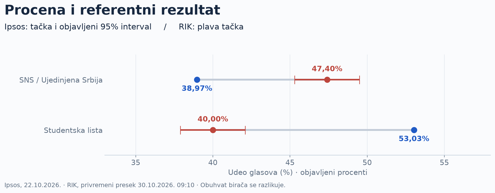
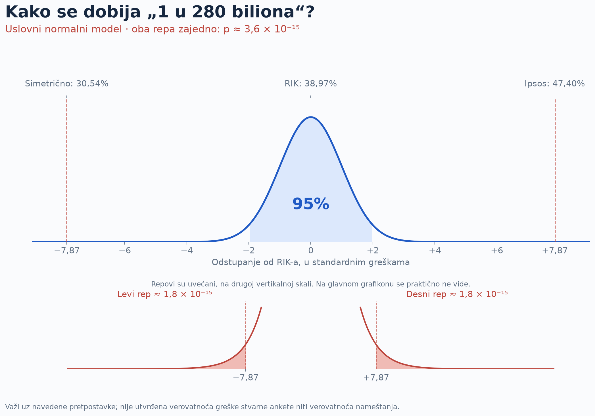
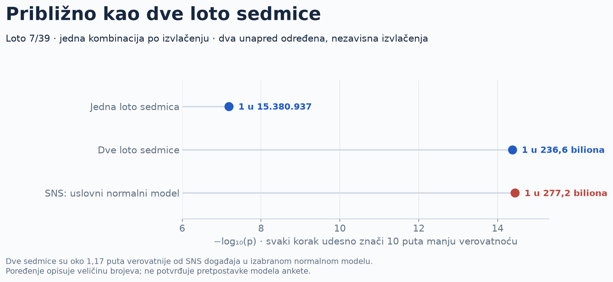

SAŽETAK ZA JAVNOST · MIHAJLO POPESKU · 01.11.2026.

# Šta znači „1 u 280 biliona“?

Ipsosova procena, rezultat RIK-a i poređenje sa Lotom 7/39. Objašnjenje koje može da se pročita, proveri i ponovi.

<strong>Šta računamo:</strong> koliko bi, u normalnom modelu sa objavljenom preciznošću, bilo retko odstupanje za SNS od najmanje 8,43 procentna poena u bilo kom smeru. Ovo nije utvrđena verovatnoća greške stvarne ankete niti verovatnoća nameštanja.

## Prvo podaci, pa verovatnoća

Ipsos je 22. oktobra 2026. objavio **47,40% za SNS / Ujedinjenu Srbiju** i **40,00% za Studentsku listu**, uz 95% interval od ±2,10 procentnih poena za svaku. U korišćenom privremenom preseku RIK-a od 30. oktobra, udeli su **38,97%** i **53,03%**. Razlike su **+8,43** i **−13,03 procentna poena**.

Anketa i izbori nisu merenje u istom trenutku, a obuhvat birača se razlikuje. Zato je potrebno jasno reći pod kojim pretpostavkama se poređenje pretvara u verovatnoću.

## Račun za SNS u tri koraka

1. Iz objavljene margine dobijamo standardnu grešku: **2,10 ÷ 1,96 ≈ 1,071 procentni poen**.
2. Razliku delimo tom greškom: **(47,40 − 38,97) ÷ 1,071 ≈ 7,87**. Toliko je standardnih grešaka procena udaljena od reference.
3. Sabiramo oba krajnja repa normalne raspodele: **p ≈ 3,6 × 10−15**. Recipročna vrednost je oko **1 u 277,2 biliona**, zaokruženo **1 u 280 biliona**.

Na gornjoj osi su procenti, a na donjoj standardne greške. **Nula znači odsustvo odstupanja od RIK-a**, a ne nula glasova. Leva vrednost 30,54% je zamišljeni, simetrični prag. Ne predstavlja rezultat drugog istraživanja.

## Poređenje sa Lotom

U Lotu 7/39 postoji **15.380.937** kombinacija. Ako odigramo jednu kombinaciju, šansa za sedmicu u jednom izvlačenju iznosi 1 prema tom broju. Za dve sedmice, sa po jednom kombinacijom u **dva unapred određena, nezavisna izvlačenja**, verovatnoće se množe.

| Događaj | Verovatnoća | Otprilike jednom u |
| --- | --- | --- |
| Jedna loto sedmica | 6,50 × 10−8 | 15.380.937 |
| Dve loto sedmice u dva određena izvlačenja | 4,23 × 10−15 | 236,6 biliona |
| SNS: jednako veliko ili veće odstupanje, normalni model | 3,61 × 10−15 | 277,2 biliona |

**Brojevi su istog reda veličine.** Dve sedmice su oko **1,17 puta verovatnije** od događaja za SNS u izabranom normalnom modelu. Jedna sedmica je oko **18,0 miliona puta verovatnija**. Ovo nije tvrdnja da je anketa isto što i izvlačenje loptica: poređenje samo približava veličinu broja. Ne odnosi se na dve sedmice „bilo kada u životu“ niti na mnogo odigranih kombinacija.

## Gde su granice zaključka?

Račun pretpostavlja nepristrasno merenje istog biračkog tela, nepromenjenu podršku od ankete do izbora, ispravnu objavljenu preciznost i **normalnu raspodelu greške, uključujući njene krajnje repove**. Sam interval od 95% nije dovoljan da se ti repovi utvrde. U tehničkom delu pokazujemo koliko se broj menja ako promenimo širinu ili oblik raspodele.

Slučajna greška uzorka ne obuhvata sve što može da pomeri prognozu: neodaziv, izbor i ponderisanje ispitanika, model izlaznosti, postupanje sa neodlučnima, promenu mišljenja i druge izvore pristrasnosti. Bez tih podataka **ne možemo broj „1 u 280 biliona“ proglasiti stvarnom učestalošću ovakve greške Ipsosove ankete**.

Naš zaključak je precizan: **opažena razlika izuzetno je udaljena od onoga što očekuje izabrani normalni model sa objavljenom marginom**. Uzrok razlike zahteva proveru metodologije i podataka. Mali p sam po sebi ne utvrđuje nameru.

## Čitajte dalje ili proverite račun

- [Statistika 101: od uzorka do repova](https://mikelatenta.github.io/ipsos-verovatnoca-loto-2026/statistika-101.html) — objašnjenje bez prethodnog znanja statistike.
- [Tehnički izveštaj i Python notebook](https://mikelatenta.github.io/ipsos-verovatnoca-loto-2026/tehnicki.html) — pretpostavke, formule, izvršeni kod, tabele, osetljivost i istorijski dodatak za 2012.
- [Nezavisna računska provera u R-u](https://mikelatenta.github.io/ipsos-verovatnoca-loto-2026/provera-r.html) — isti ulazni podaci, drugi softver.
- [Preuzmi izvršeni notebook](../analiza.ipynb), [rezultate u JSON-u](../results.json) ili [otvori GitHub repozitorijum](https://github.com/mikelatenta/ipsos-verovatnoca-loto-2026).

## Izvori i poreklo podataka

1. **Ipsos Strategic Marketing**, [saopštenje od 22.10.2026.](https://www.ipsos.com/sr-rs/rezultati-istrazivanja-pred-parlamentarne-izbore-oktobar-2026): procene i 95% intervali, terenski rad 20–22.10, ukupno 3.624 ispitanika, 90% telefonskih i 10% onlajn intervjua. Broj opredeljenih nije objavljen. Naručilac naveden u saopštenju je lista Aleksandar Vučić – Ujedinjena Srbija.
2. **RIK**, [portal rezultata](https://www.rik.parlament.gov.rs/542645/rezultati/): ovde je zamrznut privremeni nacionalni presek **30.10.2026. u 09:10**, sa 8.339 od 8.392 obrađena biračka mesta. Regionalni brojevi sačuvani su 30.10.2026. To nisu konačni rezultati. [Ulazi u JSON formatu](https://github.com/mikelatenta/ipsos-verovatnoca-loto-2026/blob/main/data/inputs.json), [brojevi glasova](https://github.com/mikelatenta/ipsos-verovatnoca-loto-2026/blob/main/data/rik_counts.csv) i [poreklo podataka](https://github.com/mikelatenta/ipsos-verovatnoca-loto-2026/blob/main/data/PROVENANCE.md) omogućavaju proveru.
3. **Državna lutrija Srbije**, [uputstvo za Loto 7/39](https://lutrija.rs/Help/Instructions?helpTypeId=1) i [pravila igara](https://lutrija.rs/help/rules): izbor sedam brojeva od 39. Broj kombinacija i verovatnoće u ovoj analizi računaju se nezavisno, kombinatorno.
4. **AAPOR**, [standardi objavljivanja metodologije](https://aapor.org/standards-and-ethics/disclosure-standards/): izvor za potrebu objavljivanja uzorka, ponderisanja, načina prikupljanja i pretpostavki procene preciznosti.
5. **Mihajlo Popesku**, [objašnjenje objavljeno na X-u 31.10.2026.](https://x.com/visokodrustvo/status/2116459194765246791). Ovaj paket razvija isti normalni račun, dodaje poređenje sa Lotom, kod i provere osetljivosti.
6. **Goran S. Milovanović**, [referentni repozitorijum](https://github.com/GoranMilovanovic/izboriRepublikaSrbija_20261025): uzor za organizaciju javnog sažetka, tehničkog izveštaja i koda. Naš glavni račun ostaje marginalni normalni model izveden iz objavljene margine. Njegov multinomni test je drugačiji postupak; njegove rezultate ovde ne preuzimamo.

Verzija **1.0.0**, objavljena 01.11.2026. Autor: **Mihajlo Popesku**. Nove podatke treba uneti kao novu, jasno datiranu verziju; današnji živi portal ne treba poistovećivati sa sačuvanim presekom.

