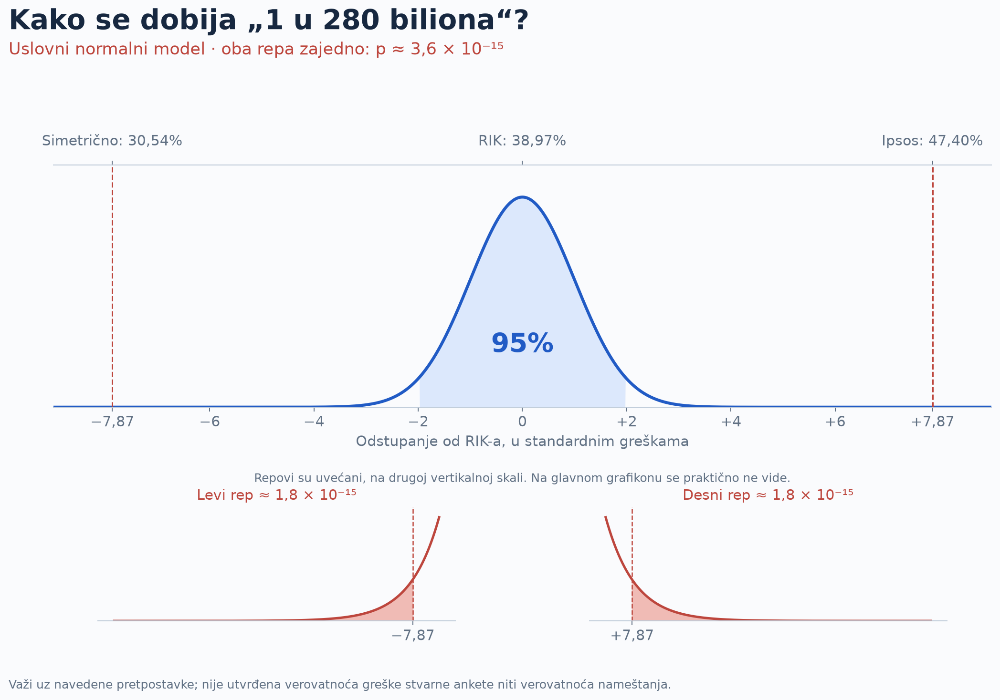
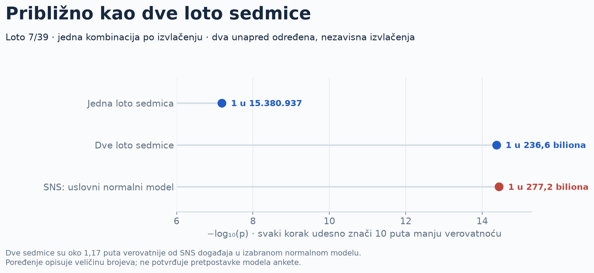

STATISTIKA 101 · OBJAŠNJENJE UZ GRAFIK

# Od uzorka do „1 u 280 biliona“

Anketa pokušava da na osnovu odgovora manjeg broja ljudi proceni šta misli mnogo veća grupa. Umesto da pitamo sve birače, pitamo uzorak. Ako je uzorak pravilno izabran i istraživanje dobro sprovedeno, njegovi odgovori mogu prilično dobro da opišu biračko telo.

## Zašto se uzorci razlikuju?

Kada bismo istog dana, na isti način, ispitali mnogo različitih slučajnih uzoraka, ne bismo svaki put dobili isti procenat. To kolebanje zovemo **slučajna greška uzorkovanja**. Veći uzorak ga obično smanjuje. U jednostavnom slučajnom uzorkovanju, približno četiri puta veći uzorak prepolovljava standardnu grešku. Ali veliki uzorak ne uklanja sistematsko izostavljanje određenih birača, neodaziv ili pristrasne odgovore.

**Procenat i procentni poen nisu isto.** Razlika između 47,40% i 38,97% je 8,43 procentna poena. To nije relativno povećanje od 8,43%.

## Šta je standardna greška?

Ona opisuje koliko procene variraju od uzorka do uzorka. Za običan, nezavisan slučajni uzorak i binarni odgovor približna formula je `SE = √[p(1−p)/n]`, gde je `p` udeo između 0 i 1, a `n` broj relevantnih ispitanika. Ponderi, grupisanje i način izbora uzorka menjaju ovu jednostavnu sliku.

Ovde **ne ubacujemo ukupnih 3.624 ispitanika u tu formulu**. Udeli lista računati su među opredeljenima, čiji broj nije objavljen, a dizajn i ponderi nisu dovoljno opisani da bismo rekonstruisali varijansu. Umesto toga, prihvatamo objavljenu marginu kao polaznu pretpostavku.

## Šta znači 95%?

U normalnom modelu, srednjih 95% procena nalazi se unutar približno 1,96 standardnih grešaka od centra. Ako je postupak nepristrasan i interval pravilno izračunat, dugoročno bi oko 95% tako konstruisanih intervala obuhvatilo fiksnu stvarnu vrednost. To nije garancija da izborni rezultat mora pasti u interval: podrška i sastav onih koji izađu mogu se promeniti.

Za objavljenu marginu od ±2,10 procentnih poena dobijamo:

SE = 2,10 ÷ 1,9599639845 ≈ 1,071448 procentnih poena

## Koliko je daleko Ipsosova procena?

RIK-ovih 38,97% koristimo kao referencu, odnosno centar modela. Ipsosovih 47,40% udaljeno je 8,43 procentna poena. Da bismo tu udaljenost izrazili u standardnim greškama, delimo:

z = (47,40 − 38,97) ÷ 1,071448 ≈ 7,867855

To je oko 7,87 standardnih grešaka. Na grafikonu nula na donjoj osi znači da nema odstupanja od RIK-a. Na gornjoj osi, na istom mestu, stoji 38,97%. Desni prag je 47,40%, a levi, simetrični prag je **38,97 − 8,43 = 30,54%**.

## Kako iz krive dobijamo verovatnoću?

Normalna raspodela ima oblik zvona. Mala odstupanja blizu centra su česta, veoma velika su retka. Ukupna površina ispod krive je 1, odnosno 100%. Površina u nekom delu krive predstavlja verovatnoću da rezultat upadne u taj deo.

Pitamo za **jednako veliko ili veće odstupanje u bilo kom smeru**. Zato sabiramo površinu levo od −7,867855 i desno od +7,867855. U normalnoj raspodeli te dve površine su jednake. Računar ih izračunava pomoću standardne matematičke funkcije; ne broji 280 biliona simulacija.

p = P(Z ≤ −7,867855) + P(Z ≥ 7,867855) p ≈ 3,608 × 10−15

Svaki rep daje polovinu tog broja. Ako bismo unapred pitali samo za precenjivanje, koristili bismo desni rep i dobili polovinu dvostrane verovatnoće. Ovde dosledno koristimo oba smera.

## Zašto „jedan u 280 biliona“?

Zapis „jedan u N“ dobija se kao `N = 1/p`. U našem računu to je približno **277.183.254.841.943**, odnosno **277,2 biliona**, zaokruženo na **280 biliona**. Bilion ovde znači milion miliona, 1012.

U zamišljenom velikom broju ponavljanja istog modela, takav ili veći promašaj očekivali bismo prosečno jednom na toliko ponavljanja. To ne znači da bi se pojavio po rasporedu. Niti računamo verovatnoću da se ispiše baš broj 47,40%: računamo sve rezultate najmanje toliko udaljene od reference.

## Kako se računa Loto?

Redosled izvučenih brojeva nije važan. Broj različitih grupa od sedam brojeva iz skupa od 39 je:

C(39,7) = 39! ÷ (7! × 32!) = 15.380.937

Uz ravnopravne kombinacije, jedna od njih je naša, pa je šansa za sedmicu `1 / 15380937`. Za dve unapred određene nezavisne runde, sa po jednom kombinacijom u svakoj, računamo `1 / 15380937²`. Dobijamo **1 u 236.573.222.997.969**, odnosno oko **236,6 biliona**. Zato je poređenje sa dve sedmice približno, a ne identično.

## Koje pretpostavke nose zaključak?

Za Loto polazimo od ravnopravnih kombinacija i nezavisnih izvlačenja. Za anketu su pretpostavke zahtevnije: isti ciljni birači i podrška, bez pristrasnosti, tačna objavljena standardna greška i normalni repovi. **Iz jednog 95% intervala ne možemo dokazati oblik krajnjih repova.** Druga raspodela može imati isti središnji interval i znatno veće krajnje verovatnoće.

Zato broj objašnjava određeni statistički model. Ne određuje verovatnoću nameštanja i sam ne razdvaja metodološku grešku, promenu podrške, izlaznost, neodaziv ili pogrešno izveštavanje. [Tehnički izveštaj](https://mikelatenta.github.io/ipsos-verovatnoca-loto-2026/tehnicki.html) pokazuje i kako se račun menja kada promenimo pretpostavke.

Ovo je proširena i računski proverljiva verzija [autorove objave na X-u](https://x.com/visokodrustvo/status/2116459194765246791). Podaci: Ipsos, 22.10.2026; privremeni RIK presek 30.10.2026. u 09:10. [Svi izvori](https://mikelatenta.github.io/ipsos-verovatnoca-loto-2026/index.html#izvori-i-poreklo-podataka).
